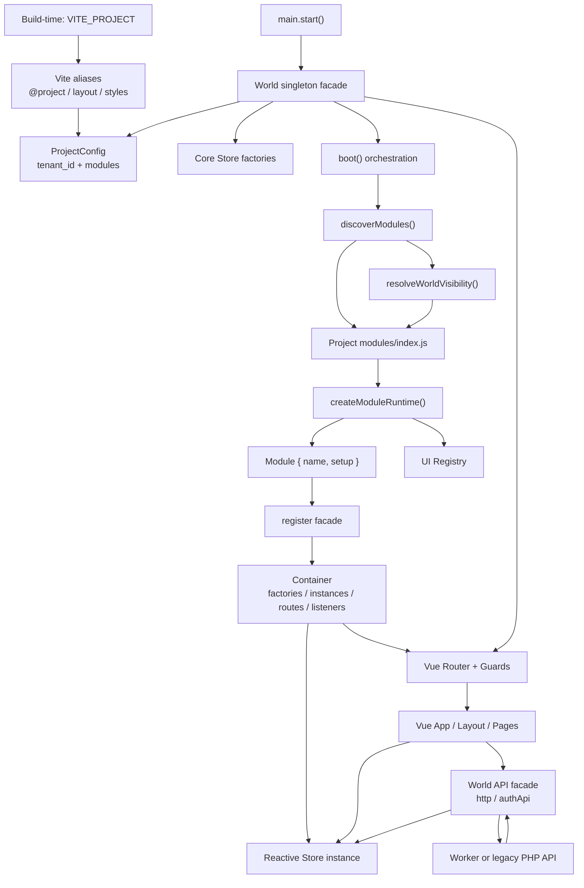

# ModuCore 架構研究報告

本報告以 `/Users/zhangyu/Desktop/mytemp/moducore_platform` 為分析對象，交叉核對 World 治理文件、前端 runtime、各 Project／Module、API 實作、Router、Store、Worker 與舊 PHP 後端。

狀態標示：

- **已實現**：可由目前程式碼直接確認。
- **設計上可能支援**：介面或治理文件已描述，但 runtime 尚未完整落地。
- **目前無法確認**：缺少實作、測試或實際呼叫點。

本次僅進行唯讀研究，未修改 ModuCore 專案檔案。

---

## 一、總結

ModuCore 的核心不是傳統意義上的 Vue 應用框架，而是一套「先決定 World，再允許 Project 中的 Module 回報自己能提供什麼」的組裝模型。

其實際運作可以濃縮為：

1. Build 時用 `VITE_PROJECT` 選定唯一 Project。
2. Runtime 建立一個全域唯一的 `World` facade。
3. World 先註冊平台核心 Store。
4. Boot 從目前 Project 的 module registry 取得候選模組。
5. Boot 產生受限的 `register` facade。
6. Module runtime 載入模組的 `{ name, setup }` 宣告。
7. Runtime 把 `setup.stores/routes/ui` 反向交回平台註冊。
8. Router 在註冊完成後才組成最終路由。
9. Vue app 最後才 mount。

這裡的「反向註冊」並不是模組由 World 寫死引用，也不是完整的依賴注入系統；它是「平台向 Project registry 要求安裝，registry 再把模組宣告透過 callback 回填到平台」。

目前實作只完整涵蓋 Store factory、Route 與 UI slot 的宣告式掛入；正式的 module `init`、module-level `dispose`、依賴圖與完整 reset/reinstall 尚未落地。

---

## 二、核心架構圖



Project 在 build-time 的選擇由 `VITE_PROJECT` 和 Vite aliases 固定；`@project`、專案 Layout 與主樣式都在建置時指向同一個 Project。

證據：`platform/frontend/vite.config.js`，`defineConfig()` 第 8–42 行。

因此目前不是同一個瀏覽器 runtime 內的多 Project 系統，而是「同一份平台原始碼可各自建出不同 World」。

---

## 三、World、Container、Boot、Store、API、Router 的責任

| 構件 | 實際責任 | 不負責的事項 |
|---|---|---|
| World | 單例 runtime facade；持有啟動狀態、ProjectConfig、Router、API 與 context；公開 Store／Service／Router 存取 | 不直接承載業務資料 |
| Boot | 協調 config、discovery、visibility、registration、runtime phase | 本身不保存狀態；目前也沒有真正執行 module init |
| Container | 保存 core/module factories、lazy instances、平台 services、routes、內部事件 listeners | 不做權限判斷、不發 API、不決定 Project |
| Store | Vue reactive 前端狀態投影；部分 Store 可持久化至 localStorage | 不是後端事實權威 |
| API | 統一 fetch、Project header、Token、401 session 清理；auth API 直接同步核心 Store | 不參與 Module discovery 或 registration |
| Router | 從已註冊 routes 組成 root children；執行最後一層登入 gate | 不應決定模組是否存在 |

### 1. World

`World` 是實際 runtime 的最上層 facade，而且匯出的是單一實例，不是由 Vue plugin 或每次 request 建立的新物件。

證據：`platform/frontend/src/world.js`，`class World` 第 12 行；`export default new World()` 第 221 行。

`World.start()` 的實際順序是：

- `_registerCoreStores()`
- `loadProjectConfig()`
- 建立 browser/server-like context
- `initApi()`
- `boot()`
- `createAppRouter()`
- 保存 runtime 引用並標記 `started`

證據：`platform/frontend/src/world.js`，`start()` 第 51–91 行。

World 對外暴露：

- `store()`、`hasStore()`、`service()`、`list()`
- `http()`、`authApi()`、`apiMode()`
- `router()`、`projectConfig()`、`appProps()`
- `createStore()`、`registerUISlot()`

證據：`platform/frontend/src/world.js` 第 157–218 行。

所以 World 的實際角色是「平台 facade＋啟動協調者＋runtime reference holder」，不是資料容器本身。

### 2. Boot

`boot()` 明確排列：

```text
assertPlatformBoundary
→ syncPlatformConfig
→ resolveBootVisibility
→ registerAllowedModules
→ initModules
→ enterRuntime
```

證據：`platform/frontend/src/app/boot/boot.js`，`boot()` 第 7–21 行。

但目前：

- `assertPlatformBoundary()` 是空函式。
- `initModules()` 是空函式。
- `enterRuntime()` 只把 lifecycle 設為 `ready`，並把 allowList 寫入 module Store。

證據：`platform/frontend/src/app/boot/boot.js` 第 23–24、67–75 行。

因此「Phase 6 Module Initialization」目前只有文件語意，沒有對應的 module hook 執行。正式文件宣稱會呼叫 module init lifecycle（`_VibeCore/world/04_WORLD_LIFECYCLE.md` 第 122–134 行），但程式碼尚未實現。

### 3. Container

Container 內部實際有六類資料：

- `coreFactories`
- `moduleFactories`
- `instances`
- 固定 `services`
- `routes`
- `listeners`

證據：`platform/frontend/src/app/container/container.js`，`constructor()` 第 4–12 行。

Factory 註冊後不立即建立 Store；第一次 `resolve(name)` 才執行 factory 並快取 instance。

證據：`container.js`，`resolve()` 第 39–52 行。

重複註冊規則不一致：

- Core factory 重複註冊會拋錯。
- Module factory 重複註冊會先 dispose 舊 instance，再覆寫 factory。

證據：`container.js`，`register()` 第 14–37 行。

這與治理文件「重複註冊不得被默許」並不完全一致；目前 module scope 實作上允許替換。

Container 沒有 `registerService()`。平台 services 是 import 時就建立的固定物件：

- `resolveNavProjection`
- `eventBus`
- `storage`

證據：`platform/frontend/src/app/container/services/index.js` 第 19–30 行。

因此現有 Container 所稱的 module capability，工程上主要是「Store factory」，不是任意 service/capability 的通用註冊器。

### 4. Store

平台核心 Store 包括：

- `auth`
- `lifecycle`
- `module`
- `platformConfig`
- `token`

證據：`platform/frontend/src/app/stores/index.js`，`coreStoreFactories` 第 8–14 行。

`createStore()` 使用 Vue `reactive` 或 `ref`，提供 `get/set/clear/loadFromStorage/flushPersist`，並可附加 actions。

證據：`platform/frontend/src/app/stores/_storeFactory.js`，`createStore()` 第 126–291 行。

持久化特性：

- 僅指定 `storageKey` 才嘗試 localStorage。
- 寫入有 debounce。
- 可用 `persistKeys` 限制欄位。
- 無 DOM／localStorage 時會變成純記憶體 Store。
- factory 建立時立即 `loadFromStorage()`。

核心 `authStore` 和 `tokenStore` 分別使用 `auth`、`token` localStorage key。

證據：`authStore.js` 第 4–9 行；`tokenStore.js` 第 4–9 行。

不過 Container 並未管理所有狀態：

- ModuDesk Tasks 直接維護 module-scope Vue `reactive` singleton，而非註冊 Store（`useTasks.js` 第 2–19 行）。
- ModuDesk Calendar 使用 module-scope cache、hydrate promise 與 timer（`calendarEventsStore.js` 第 4–12 行）。
- DineCore staff auth 另有一份 project-level reactive session state（`dineCoreStaffAuthService.js` 第 1–22 行）。

因此「所有 World 狀態由 Container 管理」不是目前程式碼事實。更精確地說，Container 管理已註冊的 Store instances；專案中仍存在多套容器外狀態。

### 5. API

平台 API 不是註冊進 Container 的 capability，而是 World 直接引用的 module singleton。

`apiRequest()` 負責：

- 加入 `X-Project`
- 讀取 token Store
- 加入 Bearer token
- JSON encode/decode
- 401 時清空 auth/token

證據：`platform/frontend/src/app/api/index.js`，`apiRequest()` 第 20–70 行。

`authApi.login/logout/restoreSession()` 會直接更新 `authStore` 與 `tokenStore`。

證據：`platform/frontend/src/app/api/index.js` 第 72–119 行。

部分模組透過 `world.http()` 使用 API，但 FlowCenter API 等程式直接 import `@/app/api`，例如 `projects/flowCenter/modules/announcement/api/announcementApi.js` 第 1 行。因此「模組只透過 World 公開 API 接觸 backend」目前並未全面成立。

後端本身沒有 World、Container 或 Module runtime：

- Worker 使用 path→method→handler Map（`platform/worker/src/index.js` 第 5–35 行）。
- 舊 PHP 後端建立自己的 `Router` 並載入 routes（`platform/backend/public/api.php` 第 10–18 行）。

所以 ModuCore World 模型目前主要是前端架構；後端是獨立 API runtime。

### 6. Router

Router 一定在 module registration 之後建立：

- `boot()` 完成。
- `buildRoutes()` 讀取 Container route bucket。
- 建立 Vue Router。
- 安裝 auth guard。
- 訂閱後續 `routes-updated`／`routes-reset`。

證據：`platform/frontend/src/router/index.js`，`createAppRouter()` 第 12–67 行。

所有 module routes 都成為 Project Layout root 的 children。

證據：`platform/frontend/src/router/routes.js`，`buildRoutes()` 第 19–46 行。

Guard 只處理：

- public
- auth-only
- disabled

其登入真相只取 `world.store('auth')`。

證據：`platform/frontend/src/router/guards.js`，`setupAuthGuard()` 第 5–53 行。

角色、公司或更細的身份條件不是共享 guard 的責任；例如 FlowCenter 在 Layout 中額外執行 route access 判斷（`flowCenter/layout/LayoutRoot.vue` 第 15–37 行）。

另有一項文件過時：`_VibeCore/AI_PROJECT_ENTRY.md` 第 246–249 行仍說 module routes 累積在 `window` bucket；實際程式已改為 `Container.routes: Map`（`container.js` 第 10、71–89 行）。

---

## 四、啟動流程

### Build-time

1. Vite 讀取 `VITE_PROJECT`，預設 `project-a`。
2. 建立 `@project`、Project Layout、Project styles aliases。
3. `import.meta.glob()` 轉成可用的 Project/module loader 集合。
4. 一份 build 對應一個 Project／tenant World。

Project config 雖然在 runtime 以 async loader 取出，但候選檔案與 `@project` alias 已由 Vite build 決定。

證據：`platform/frontend/projects/loadProject.js`，`loadProjectConfig()` 第 3–21 行。

### Runtime

```text
main.start()
  └─ await world.start()
      ├─ 註冊 core store factories
      ├─ 載入 ProjectConfig
      ├─ 建立 context
      ├─ 初始化 API project name
      ├─ boot()
      │   ├─ 寫入 platformConfig Store
      │   ├─ discovery
      │   ├─ visibility
      │   ├─ install/register modules
      │   └─ lifecycle = ready
      ├─ 建立 Router
      └─ 保存 runtime references
  └─ createApp(App)
      ├─ use(router)
      └─ mount('#app')
```

入口證據：`platform/frontend/src/main.js`，`start()` 第 7–24 行。

---

## 五、反向註冊的完整運作

### 1. 宣告與發現

每個 Project 的 `modules/index.js` 使用：

```js
const modules = import.meta.glob('./*/index.js')
const runtime = createModuleRuntime(modules)
```

例如：`platform/frontend/projects/project-b/modules/index.js` 第 1–16 行。

`listModules()` 只從 loader path 產生 `{ name }`，不載入 module definition。

證據：`platform/frontend/projects/moduleRuntime.js`，`listModules()` 第 55–59 行。

`discoverModules()` 再把它縮成 `{ name, status: 'declared' }`。

證據：`platform/frontend/projects/moduleDiscovery.js` 第 17–31 行。

### 2. Visibility

`resolveWorldVisibility()` 理論上支援 `mod.meta.access` 與 auth context。

證據：`platform/frontend/src/core/visibility.js` 第 5–19 行。

但目前 discovery 結果沒有 `meta`，ProjectConfig 的 modules 也只是字串，因此實際可見性只驗證：

- 模組名稱存在。
- 名稱在 ProjectConfig modules 中。

登入／公開條件目前不會在 module registration 前排除 module。所有設定中的 module 都會安裝，真正的登入限制落在 route guard。

這與 World 文件要求「不可見模組不得註冊」存在實作落差（`_VibeCore/world/02_WORLD_BOUNDARIES.md` 第 81–92 行）。

### 3. 平台建立註冊權限

Boot 不把 World 的所有能力交給模組；它建立 `createRegister(container)`，再呼叫 registry：

```js
registry.installModules({ register, container }, { allowList })
```

證據：`platform/frontend/src/app/boot/boot.js`，`registerAllowedModules()` 第 57–65 行。

雖然 raw container 被放在參數中，但目前 `createModuleRuntime.installModules()` 只解構 `{ register }`，沒有使用 raw container。

證據：`platform/frontend/projects/moduleRuntime.js` 第 61 行。

### 4. 模組載入與回註冊

允許的 module 依序 lazy import；module definition 預期為：

```js
{
  name,
  setup: {
    stores,
    routes,
    ui: { slots }
  }
}
```

例如 Notification module 同時輸出 Store、Route、UI slot（`project-b/modules/notification/index.js` 第 7–24 行）。

Runtime 對每個 module 執行：

- `register.store(storeName, factory)`
- `register.routes(routes, { moduleName })`
- `world.registerUISlot(slotName, descriptor)`

然後記錄至 `installedModules`。

證據：`platform/frontend/projects/moduleRuntime.js`，`installModules()` 第 61–97 行。

這就是目前真正的反向註冊。

### 5. 依賴與實體化時機

- Store factory 在安裝時註冊。
- Store instance 在第一次 `resolve/world.store()` 時才建立。
- Route descriptor 在安裝時立即寫入 route bucket。
- Route component 通常仍由 Vue Router lazy import。
- UI slot descriptor 在安裝時立即寫入全域 UI registry。
- 沒有 module dependency 宣告、拓撲排序或循環檢查。
- 安裝順序來自 glob loader key 的物件順序，而不是正式 dependency graph。

### 6. 初始化

**程式碼已實現：**

- Store factory 註冊。
- Route metadata 正規化與 access 驗證。
- UI slot 登記。
- lifecycle Store 最後設為 `ready`。

**設計上可能支援：**

- module initialization phase。
- module-specific init hook。
- 初始化失敗時的分階段中斷。

**目前無法確認：**

- 多模組 init 的先後契約。
- init 的 rollback。
- init 是否允許非阻斷 API query。
- module ready 狀態的獨立追蹤。

原因是 `initModules()` 目前完全為空。

---

## 六、Reset、銷毀與生命週期

### `World.reset()`

目前流程：

1. lifecycle → `booting`
2. 清 module Store
3. 清 PlatformConfig Store
4. 清 auth user
5. `container.reset()`
6. 再執行 `boot()`

證據：`platform/frontend/src/world.js`，`reset()` 第 110–141 行。

這裡有三個確定的生命週期落差：

1. 正式 World 定義說 reset 保留 PlatformConfig；實作先把 `platformConfigStore` 清空，之後依 `_projectConfig` 重寫。最終值通常恢復，但不是持續保留同一狀態實例內容。

2. `container.reset()` 清除 module factories、instances 和 routes（`container.js` 第 124–152 行），但 `moduleRuntime.installedModules` 沒有 reset API。重新 boot 時 module 因仍被標記為 installed 而被跳過（`moduleRuntime.js` 第 13–14、68–70、95 行）。

   依靜態呼叫鏈，reset 後 module Store 可能宣稱 allowList 已恢復，但 module factories/routes 並未重新註冊。

3. UI registry 沒有 clear/reset；slot descriptors 會跨 reset／dispose 保留（`uiRegistry.js` 第 5–18 行）。

目前沒有針對 `world.reset()` 的自動測試，因此實際 UI 結果未由測試確認；上述是直接由確定程式分支推導。

### `World.dispose()`

`dispose()` 會：

- `container.destroy()`
- 清 Router holder 並執行 router subscription cleanup
- 清 World 自身欄位

證據：`platform/frontend/src/world.js`，`dispose()` 第 143–155 行；`router/holder.js`，`setRouter()` 第 5–12 行。

但它不會清除：

- module runtime 的 `loadedModules`／`installedModules`
- UI registry
- platform `eventBus` handlers
- storage service singleton
- API module-scope `projectName`
- Project/module-scope reactive singletons

因此目前 `dispose()` 是「清掉 World 與 Container 主要 registry」，不是完整的 process-level teardown。

### Store disposal

Container 會在 instance 具有 `dispose()` 時呼叫它。

證據：`container.js`，`disposeInstance()` 第 170–176 行。

但核心 `createStore()` 及現有 module Store 並未提供通用 `dispose()`；所以這只是設計上預留的能力，尚未形成一致生命週期契約。

---

## 七、狀態與資料流

### 標準資料流

```text
Vue Page
→ module service
→ module API adapter / world.http()
→ fetch()
→ Worker/PHP backend
→ response
→ service normalize
→ registered Store action
→ Vue reactive state
→ component render
```

Employee module 是清楚範例：

- Page／component 取得 `employeeStore`。
- Service 呼叫 employee API。
- 回應寫入 Store。
- Store 同時以 session epoch 防止換身份後的延遲回應污染。

入口證據：`project-b/modules/employee/services/employeeService.js` 第 1–18 行。

### Auth 特殊流

Auth API 本身直接同時管理 auth Store 與 token Store，所以身份與 transport credential 是平台級雙 Store，而非各 module 自行保存。

### 本地資料流

ModuDesk 採：

```text
Vue composable reactive singleton
↔ repository
↔ world.services.storage()
↔ IndexedDB
  fallback → memory Map
```

Storage capability 的固定 API 和 IndexedDB→memory fallback 位於 `storageService.js`，`createStorageService()` 第 342–393 行。

這是目前 Project 應用實作，不是所有 ModuCore Module 的必要機制。

---

## 八、模組溝通與隱性依賴

### 已實現的溝通通道

1. 共享核心 Store，例如 `auth`。
2. 以公開名稱取得已註冊 module Store。
3. 平台 `eventBus`。
4. API／後端共享事實。
5. Route metadata 與 navigation projection。
6. UI slot registry。
7. Project-level 協調 service。

其中 `eventBus` 已用於 notification collector；它監聽既定事件並寫入 notification Store（`notificationCollector.js`，`attachNotificationCollector()` 第 44–56 行）。

### 實際存在的直接跨模組依賴

以下不是推測，而是直接 import：

- Task service → Notification 私有 service（`taskService.js` 第 1–3 行）。
- Vote service → Notification 私有 service（`voteService.js` 第 1–3 行）。
- Notification Page → Task、Employee、Vote 私有 services（`NotificationPage.vue` 第 1–7 行）。
- Dashboard Page → Task、Employee、Vote 私有 services 並直接要求其 Stores（`dashboard/pages/index.vue` 第 1–11 行）。
- Task mock API → Employee 私有 mock data（`taskApi.js` 第 1–4 行）。
- DineCore entry page → Visitor Stats 私有 service（`EntryLandingPage.vue` 第 1–5 行）。
- DineCore counter-map → Counter 私有 service（`CounterMapPage.vue` 第 1–6 行）。
- ModuDesk Project widget → Tasks 私有 composable（`TodaySummary.vue` 第 1–5 行）。

DineCore 的 Project service 還會同時解析 entry/cart/menu/checkout/order-tracker 五個 module Stores（`dineCoreOrderingFlowService.js` 第 50–86 行）。

所以目前答案是：模組間確實存在隱性依賴，而且不只透過 Container 名稱，還包含直接檔案 import、對其他 Store state shape 的認知，以及 Project service 的跨模組協調。

有些位置以 `world.hasStore()` 或 `try/catch` 做缺席降級，但 Dashboard 等位置會直接 resolve，仍假設相關模組一起存在。

### Layout 邊界

正式設計禁止 Layout 主動解析 Container／Store（`_VibeCore/world/03_LAYOUT_WORLD.md` 第 107–130 行）。

實際上：

- Project B Layout 解析 auth Store，並嘗試解析 employee Store（`project-b/layout/LayoutRoot.vue` 第 3–29 行）。
- FlowCenter Layout 直接讀 Container routes，並執行身份 route access（`flowCenter/layout/LayoutRoot.vue` 第 1–37 行）。

因此治理上的「Layout 純呈現層」比目前應用實作更嚴格。

---

## 九、與 Vue 等外部框架的整合

### Vue

Vue 不是透過 adapter 整合，而是深入目前 runtime：

- `main.js` 使用 `createApp()`。
- Store factory 使用 `ref/reactive/toRaw`。
- UI registry 使用 Vue `ref`。
- Project/module 狀態大量使用 `computed/reactive/watch`。
- Layout 和 Page 是 Vue SFC。

因此目前的 Store、UI、Layout 與頁面層明確依賴 Vue 3。

### Vue Router

Router 使用 `createWebHistory()`，直接依賴瀏覽器 History API。

證據：`platform/frontend/src/router/index.js` 第 7、15–17 行。

Router 沒有註冊為 Container service；World 直接持有它，另有 `holder.js` 供非 World 路徑存取。

### Vite

目前 Project 與 Module 組裝依賴：

- `import.meta.env`
- `import.meta.glob`
- Vite aliases
- Vite Vue plugin

所以 build-time World resolution 是 Vite 實作，不是框架無關的 module loader。

---

## 十、核心必要機制與應用實作的區分

### 核心必要機制

依正式 World 設計與實際主鏈共同成立：

- 一次只有一個 active World／Project。
- Project 在 build-time 決定。
- Project config 宣告 World identity 與 module 集合。
- World 作為單一 runtime facade。
- Boot 負責有序組裝。
- Module 先 discovery／visibility，再 registration。
- Container 作為公開能力與 Store 的取得閘道。
- Store 是前端狀態投影，不是 backend truth。
- API 是前後端事實交換邊界。
- Router 是已存在內容的最後進入防線。
- Module 應可缺席，不應直接假設其他 Module 存在。

World 對 Store 的正式定義見 `_VibeCore/world/01_WORLD_MODEL.md` 第 173–183 行；API／Backend truth 關係見 `_VibeCore/world/03_WORLD_API_RULES.md` 第 11–36 行。

### 目前 runtime 的具體實作選擇

這些不是 ModuCore 概念上必然要求：

- Vue 3 reactive Store。
- Vue Router `createWebHistory()`。
- Vite `import.meta.glob()`。
- `{ name, setup: { stores, routes, ui } }` descriptor 格式。
- `Map` 作為 Container registry。
- factory lazy singleton。
- localStorage Store persistence。
- IndexedDB storage capability。
- in-memory event bus。
- UI slot registry。
- route metadata 的具體 `public/auth/nav` shape。
- Cloudflare Worker + D1。
- 舊 PHP Router。
- Project-specific Layout、auth facade、API adapters、mock mode。

### 設計上存在但尚未完整實現

- Module `init` lifecycle。
- Module-level ready 狀態。
- Module-level destroy/unload hook。
- 完整可重跑的 World reset。
- 由 module metadata 驅動的 registration 前 visibility。
- Component Module 作為可註冊、跨 Module 使用的正式 capability。
- 任意 service 的 module registration。
- SSR-native 啟動與 request-scoped World。
- runtime Project 切換。
- 框架抽換層。

---

## 十一、執行環境依賴判定

| 範圍 | 瀏覽器／DOM | Vue | Vite | 特定後端 |
|---|---:|---:|---:|---:|
| World 治理概念 | 否 | 否 | 否 | 否 |
| `Container` 類別核心 registry | 基本上否 | 否 | 否 | 否 |
| 現有 Store factory | localStorage 可選，但實際常用 | 是 | aliases | 否 |
| 現有 World boot | 部分 | 間接是 | 是 | 否 |
| Router | 是 | 是 | 是 | 否 |
| UI／Layout／Pages | 是 | 是 | 是 | 否 |
| API client | Web `fetch` | 否 | env | 否 |
| storage service | IndexedDB；失敗可退 memory | 否 | 否 | 否 |
| Worker backend | Cloudflare Worker APIs | 否 | 否 | Cloudflare/D1 |
| 舊後端 | PHP runtime | 否 | 否 | PHP/MySQL |

明確結論：

- ModuCore 的「設計哲學」不必然依賴 Vue 或瀏覽器。
- 目前可執行的前端實作明確依賴 Vue、Vue Router、Vite 與 browser APIs。
- `World` 雖然建立了 `isServer` context（`world.js` 第 58–70 行），但 `createWebHistory()`、`main.js` mount、`apiMode()` 直接讀 `window.location`，尚不能視為 SSR-ready。
- Container registry 本身可被移植到非瀏覽器環境；完整 ModuCore frontend runtime 目前不行。
- 尚無非 Vue adapter、React/Svelte 實作或對應測試，因此「可跨框架」目前只能列為設計上可能支援，不能列為已實現。

---

## 十二、最終架構判讀

ModuCore 的主要設計哲學是：

> Project 在 build-time 宣告一個 World；Platform 在 runtime 建立穩定基底；Module 不主導啟動，而以宣告方式把 Store、Route、UI 回註冊到平台；Container 保存可被世界承認的能力與狀態投影；Router 和 API 分別處理進入防線與外部事實交換。

它與一般框架最明顯的差異，不是使用了某種既有模式，而是把「存在」本身視為需要經過 World 承認的語意：

- 檔案存在不代表 Module 存在。
- Route 存在不代表能力存在。
- Store 有資料不代表資料是真相。
- API 回應不負責決定 World 結構。
- Project 不是 runtime tenant switch，而是一份獨立 build 的 World 藍圖。

目前 runtime 已把 discovery→registration→router 這條主鏈實現，但治理文件描述的完整生命週期、缺席隔離、visibility、reset 與純 Layout 邊界尚未完全對齊。這些落差是目前架構的實際狀態，不應誤讀成已存在的機制。

